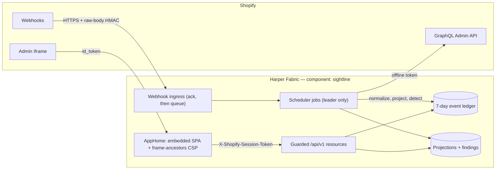

# Sightline by Harper

Sightline is a Shopify operational flight recorder: a read-only record of what happened in a store, when, and where an expected operational confirmation is missing.

It runs parallel to Shopify's delivery path. It never proxies merchant traffic or sits between Shopify and fulfillment, inventory, ERP or other systems; if Sightline is down, the store carries on. An absence finding means Sightline has not observed the expected confirmation **in Shopify**. It does not prove that a warehouse, carrier, 3PL or other vendor failed, and every screen, export and document here holds that line.

## Quickstart

```bash
cd app
npm ci
npm test                # unit, integration, contract and UI tests (node --test, no browser)
npm run typecheck && npm run lint:required && npm run format:check
```

To run the component locally, see [Running locally](#running-locally). To deploy, see [Deploying](#deploying).

## Status

**Record**, the free MVP, is built and runs embedded in a Shopify dev store. App Store launch readiness is tracked in [issue #26](https://github.com/HarperFast/harper-sightline/issues/26) and the [App Store review checklist](docs/app-store-review-checklist.md).

| | |
|---|---|
| Runtime | Harper v5 component `sightline`, deployed to Harper Fabric. Local verification used Harper **5.3.3** |
| Toolchain | Node 24, TypeScript run by type stripping (no backend build), Vite for the SPA |
| Runtime dependencies | none (Node built-ins and the `harper` runtime) |
| Shopify | Admin API and webhooks pinned to `2026-07`; five read scopes; Protected Customer Data Level 1 only |
| Public API | `/api/v1`, pinned in [`contracts/sightline-api-v1.json`](contracts/sightline-api-v1.json); a test fails if the code drifts from it |
| Retention | 7 days, by physical delete |

Known gaps:

- **No digest sender.** Digests are built and written to an outbox with `status: 'pending'`; nothing sends them.
- **Secrets custody is not initialised on the dev Fabric instance**, so the three required secrets must be supplied as instance environment variables there. The old dev app secret in git history still needs rotating. See [security review §1.1](docs/security-review.md).
- **The App Store listing creative is not corrected yet** ([checklist §3](docs/app-store-review-checklist.md)).

## What a merchant gets

Installed from Shopify and opened in Shopify Admin, with nothing to configure, Sightline:

- records seven days of order, fulfillment, inventory and refund activity;
- searches a normalized operational timeline and an orders worklist;
- shows order-to-fulfillment flow and activity summaries;
- flags paid, fulfillment-eligible orders with no observed Shopify fulfillment confirmation, shows the evidence, and resolves the finding when a webhook or a reconciliation pass supplies the confirmation;
- exports any filtered list as CSV;
- shows recording health, granted access, retained data and privacy behaviour.

Not in the MVP: replay, repair or any Shopify write; billing; connectors or claims about downstream vendors; multi-store dashboards; customer-domain capture; Pub/Sub or EventBridge ingestion. Paid capabilities exist only as boundaries that return `false` (`app/src/auth/capabilities.ts`).

## Architecture



| Concern | Decision |
|---|---|
| Runtime | One Harper v5 component: database, resources, scheduler jobs and static assets |
| Interface | Shopify App Home with App Bridge and Polaris web components, loaded from Shopify's CDN |
| Browser auth | Shopify session JWT in `X-Shopify-Session-Token`, verified per request. Harper intercepts `Authorization`, hence the custom header ([ADR-001](docs/adr/ADR-001-authentication.md)) |
| Background Shopify access | Expiring offline access and refresh tokens, stored as AES-256-GCM envelopes, rotated before use |
| API surface | Custom resources only; no table is `@export`ed |
| Tenant isolation | Every read takes `shopId` from the verified principal, never from input; an adversarial cross-tenant test suite attacks every endpoint |
| Data model | Sealed GraphQL schema in two databases (`sightline_core`, `sightline_ledger`), shop-namespaced keys, PCD Level 1 data only ([ADR-003](docs/adr/ADR-003-retention-deletion.md)) |

## HTTP API

| Route | Auth | What |
|---|---|---|
| `GET /` and its assets | none | The embedded SPA; the HTML carries a `frame-ancestors` CSP for the verified shop |
| `GET /privacy-policy` | none | The public privacy policy |
| `GET /api/v1/health` | none | Liveness |
| `GET /api/v1/{session,setup,summary,events,events/:id,flows,orders,orders/:orderId,findings,findings/:id,privacy}` | session token | The read API |
| `GET /api/v1/export/{events,findings,orders}.csv` | session token | CSV of a filtered list, at most 5,000 rows; `x-sightline-truncated` says when there were more |
| `GET`/`PUT /api/v1/digest` | session token | Sightline's own notification settings: the only write, never Shopify data |
| `POST /webhooks/shopify/events` | raw-body HMAC | Order, fulfillment, inventory, refund and `app/uninstalled` deliveries |
| `POST /webhooks/shopify/compliance/*` | raw-body HMAC | The three mandatory compliance webhooks |
| `GET /api/v1/ops` | `SIGHTLINE_OPS_TOKEN` | Operator health; 404 while the token is unset |

Every read's response fields are allowlisted in `app/src/api/apiContract.ts` and published in [`contracts/sightline-api-v1.json`](contracts/sightline-api-v1.json). After an API change, run `npm run contract:gen` and commit the result.

**Pagination.** Lists return `{ items, nextCursor }`, 25 rows by default and 100 at most. The cursor is an opaque keyset position (sort value plus row id), so rows tied on the sort value page without gaps or repeats. A list filtered by `resourceId` reads without the shop in the query and checks the tenant on each row; it reads at most 1,000 rows per page, and a page that reaches that limit ends without a cursor rather than build one from another shop's row.

**Rate limits** (`app/src/auth/rateLimit.ts`). Per shop: 200 requests a minute across all reads, and 10 CSV exports a minute. Over a limit the API returns 429 with `Retry-After`. The counters live in each worker thread, so the effective ceiling is the limit times the worker threads. A soft damper on one shop's demand, not a quota or a security boundary.

**Export gate** (`app/src/api/exportGate.ts`). One CSV export runs at a time per worker thread; a second concurrent export on that thread gets 429 with `Retry-After: 5`. Exports yield to the event loop between pages, so webhook acks on the same thread keep moving (figures in [DESIGN.md, Measured costs](app/DESIGN.md#measured-costs-local-harper-533-laptop)).

## Webhook flow

1. **Ingress** (`app/src/resources/shopifyWebhook.ts`) verifies the HMAC over the raw body before parsing, binds the delivery to its shop (a shop named in the body must match the header, and the shop must already be installed, or 404), stores an allowlisted copy of the body (`app/src/privacy/pii.ts`: the `include_fields` registered in `shopify.app.toml`, and inside line items only the SKU and quantity fields), and acks. Delivery ids are `shopId:webhookId`, so a redelivery is a no-op.
2. **Drain** (`sightline-process`, every 10 s on the scheduler leader) works through accepted deliveries for up to 8 s per occurrence. Shops take turns of up to 250 deliveries, oldest first within a shop, so one shop's backlog cannot hold back another's.
3. Each delivery is normalized; its event and SKU index rows are written in one transaction; the order's projection and findings are rebuilt from its events. The stored body is cleared once the delivery is processed.
4. **Failures.** A failed delivery is retried once per occurrence and dead-letters after 5 attempts; a delivery that can never succeed (malformed body) dead-letters at once. An occurrence stops after 50 failures.
5. **Reconciliation** (`sightline-reconcile`) re-reads changed orders from the Admin API and fills in anything a webhook missed.

A dead-lettered delivery keeps its body until the purge, for the operator ([dead-letters runbook](docs/runbooks/dead-letters.md)).

## Background jobs

All periodic work runs as Harper scheduler jobs, declared in [`app/config.yaml`](app/config.yaml) under `scheduler:` and handled by the `*Job` exports of `app/jobs.ts`. Each occurrence runs once, on the elected leader. The scheduler has no stall timeout, so each handler gives up waiting after its stall budget (`app/src/jobs/tick.ts`) and the next occurrence starts fresh.

| Job | Every | Stall budget | What |
|---|---|---|---|
| `sightline-process` | 10 s | 5 min | Drain accepted deliveries (above) |
| `sightline-state-backfill` | 1 min | 10 min | Fill the derived `state` column on older projections; writes nothing once converged |
| `sightline-ops-snapshot` | 1 min | 5 min | Log the `ops.snapshot` health line |
| `sightline-detect` | 5 min | 15 min | Expire pending expectations whose deadline passed |
| `sightline-reconcile` | 10 min | 30 min | Reconcile each shop against the Admin API (the first pass backfills 7 days) |
| `sightline-inventory-enrich` | 15 min | 30 min | Resolve inventory items to product/variant titles and location names |
| `sightline-purge` | 5 min | 30 min | Retention purge (below); no pass at boot |
| `sightline-digest` | 15 min | 45 min | Build each subscriber's digest for the last complete period |

A leader failover pauses every job for about 4 to 6.25 minutes (from the Harper 5.3.3 scheduler source; [DESIGN.md](app/DESIGN.md)). Webhooks are still acked and stored meanwhile, and the new leader drains them; `ops.snapshot` reports the backlog as stale until it does.

## Retention

- The ledger (deliveries, events, SKU index rows, projections, expectations, findings, aggregates, redaction tombstones) is deleted after **7 days**; the digest outbox after **30 days** ([ADR-003](docs/adr/ADR-003-retention-deletion.md), [data inventory](docs/data-inventory.md)).
- `sightline-purge` runs every 5 minutes on the leader, deletes in batches within a time budget, and re-queries to confirm nothing expired remains.
- Rows still present 30 minutes past their window turn `/api/v1/ops` unhealthy (`retention.overdueRows`, counted up to 1,000 per table).
- Inventory item and location caches are not aged out; `shop/redact` erases them.

## Privacy and redaction

Sightline stores no customer name, email, phone or address ([data inventory](docs/data-inventory.md)).

- **`customers/redact`** deletes the named orders' rows, clears the stored bodies of the shop's deliveries about those orders (queued, dead-lettered, and processed ones that still hold a body), writes one audit row, and leaves a 7-day **tombstone** per order.
- **`shop/redact`** erases every shop-scoped table and leaves a shop tombstone.
- **Uninstall** (`app/uninstalled`) marks the shop uninstalled and deletes its credential and digest subscription. The rest stays until Shopify's `shop/redact`, which follows an uninstall; ledger rows also age out after 7 days.
- **Tombstones** make the drain and the reconcile sweep drop matching data instead of writing it back, including a delivery that was already queued or being written when the request arrived. They hold only the shop and order ids and expire with the ledger.
- Not closed: a delivery processed on another node before the tombstone replicates there can still be written; the 7-day purge removes it.
- The public policy is served from `app/src/privacy/privacyPolicy.ts`. Draft wording that mentions tombstones awaits legal review in the data inventory.

## Observability

Logs are single lines, `[sightline] {"level","event",...}`, passed through a redactor that masks tokens, HMACs, secrets, payloads and customer PII (`app/src/observability/observe.ts`). Metrics are in-process counters with no shop label; the `ops.snapshot` line (once a minute, at `warn` when unhealthy) carries the leader thread's counters and the health view also served at `/api/v1/ops`:

- backlog count and oldest age (stale past 5 min), dead-letter count, both capped at 10,000 and flagged `capped`;
- reconciliation staleness (30 min), shops needing reauthorization, rows overdue for the purge;
- `healthy` is false on any dead letter, a stale backlog or reconciliation, or overdue rows.

Counters worth alerting on:

| Counter | Means |
|---|---|
| `webhook.signature_fail` | Webhooks refused for a bad HMAC |
| `process.dead_lettered`, `process.error` | Deliveries that will not be processed; drain occurrences that threw |
| `process.redacted_dropped` | Deliveries dropped under a redaction tombstone (non-zero only around a redaction) |
| `process.skus_dropped` | SKUs past the 500-per-event cap (should stay zero) |
| `process.keyless_skipped` | Pending rows with no key or shop, passed over each lap ([webhook-backlog runbook](docs/runbooks/webhook-backlog.md)) |
| `rate_limit.requests`, `rate_limit.exports` | 429s from the per-shop limits; non-zero in normal use means a limit is too low |
| `export.busy` | Exports refused because another was running on the thread |

The full list is the `M` object in `observe.ts`. The [runbooks](docs/runbooks/README.md) map each alert to a runbook and an owner.

## Configuration

Runtime secrets are read from Harper scoped secrets (`set_secret` with `grants: ['sightline']`) and then from `process.env` (`app/src/secrets/secretsPolicy.ts`). `config.yaml` declares the three required ones, so a deploy missing one fails at load with a named reason (`missing`, `ungranted` or `custody-unavailable`).

| Variable | Used by | Notes |
|---|---|---|
| `SHOPIFY_API_SECRET` | app (required) | Verifies webhook HMACs and session tokens |
| `SIGHTLINE_TOKEN_KEY` | app (required) | 32-byte hex; encrypts stored Shopify tokens. Cannot be rotated once tokens exist |
| `SIGHTLINE_OPS_TOKEN` | app (required), loadtest | Gates `/api/v1/ops`; under 32 characters counts as unset |
| `SHOPIFY_API_KEY` | app, smoke | The app's public client id |
| `SIGHTLINE_SUPPORT_EMAIL`, `SIGHTLINE_SUPPORT_URL`, `SIGHTLINE_POLICY_UPDATED` | app (optional) | Support contact and the policy's effective date |
| `HARPER_OPS_URL`, `HARPER_USER`, `HARPER_PASS` | deploy, set-secrets | Operations API of the target instance |
| `SIGHTLINE_BASE` | deploy, smoke, loadtest | Public base URL of the component |
| `SMOKE_WEBHOOK`, `SMOKE_RATE_LIMIT`, `SMOKE_UNINSTALL` | smoke (optional) | Opt-in checks that write data; staging only |
| `LOAD_SHOP`, `LOAD_RPS`, `LOAD_DURATION`, `LOAD_TOPIC` | loadtest | `LOAD_SHOP` must be an installed shop, or every webhook gets 404 |

`app/.env.example` lists the deploy-side ones. TLS verification stays on; for a self-signed host, set `NODE_TLS_REJECT_UNAUTHORIZED=0` on the one command, never in `.env`.

## Running locally

Every live measurement in this repo was taken on Harper **5.3.3** installed from npm (`npm i harper@5.3.3` in a scratch directory). The globally installed `harper` CLI on the dev machine is 5.2.0 and was not used; a report that it fails on secrets is unverified here, so use 5.3.3. A local root has no secrets custody, so the secrets come from the environment.

```bash
export HOME=/tmp/sightline-home ROOTPATH=/tmp/sightline-root DEFAULTS_MODE=dev TC_AGREEMENT=yes
export HDB_ADMIN_USERNAME=admin HDB_ADMIN_PASSWORD=<password>
export HTTP_PORT=9926 OPERATIONSAPI_NETWORK_PORT=9925 THREADS_COUNT=2
export SHOPIFY_API_KEY=<client id> SHOPIFY_API_SECRET=<any 32+ chars>
export SIGHTLINE_TOKEN_KEY=$(openssl rand -hex 32) SIGHTLINE_OPS_TOKEN=$(openssl rand -hex 16)
cd app && <path to harper 5.3.3>/node_modules/.bin/harper run .
```

Then, from `app/`, with the same secret:

```bash
SIGHTLINE_BASE=http://127.0.0.1:9926 SHOPIFY_API_KEY=<client id> SHOPIFY_API_SECRET=<secret> npm run smoke
node scripts/seed-dev-data.mjs --dry-run --shop=<store>.myshopify.com   # validates a seed offline
```

`npm run dev` serves the SPA alone through Vite; there is no backend behind it. On macOS one worker thread served every request in local runs, so per-thread limits behave as per-node there.

## Deploying

The pipeline, environments and secret inventory are in [docs/deployment.md](docs/deployment.md).

- **CI** (`.github/workflows/ci.yml`, every PR and push to `main`): format, lint, typecheck, tests, UI tests, coverage, SPA build, `npm audit`, and a scan for committed Shopify tokens and secrets.
- **CD** (`.github/workflows/deploy.yml`): manual dispatch or a published release, per GitHub Environment (`staging`, `production`). Locally, `npm run deploy` does the same against `.env`.

`npm run deploy` (`app/scripts/deploy.mjs`):

1. Builds the SPA, packages `app/` and calls `deploy_component`.
2. Finds every node of the cluster and restarts each by its own hostname: component code does not replicate, so a restart through the load balancer reaches one node.
3. Checks that each node, and the load-balanced hostname over 8 probes, serves the SPA bundle the build produced.
4. Re-creates any column of `schema.graphql` that `describe_table` does not list (the Fabric `@sealed` column-add flake).
5. Checks every `@indexed` attribute with `describe_table` and `include_computed: true`, including the computed `WebhookDelivery.pendingKey`; a missing index exits non-zero.

Then run `npm run smoke` against the host. Rollback is a deploy of an earlier ref ([deployment-rollback runbook](docs/runbooks/deployment-rollback.md)).

### Before the first production deploy

1. Restore Harper secrets custody on the instance; `node app/scripts/set-secrets.mjs --check` must report a key (it refuses to write without one).
2. Rotate the Shopify app secret in the Partner Dashboard.
3. Provision the three secrets with `app/scripts/set-secrets.mjs`, then redeploy and confirm the component loads.
4. After the first deploy, confirm by hand with `describe_table` (with `include_computed: true` for `WebhookDelivery`) that `pendingKey` is indexed and that `sightline_ledger.RedactionTombstone` exists with its `shopId` and `redactedAt` indexes. `deploy.mjs` runs the same index check, but a computed attribute on a sealed Fabric table has not been deployed before.
5. Measure webhook ack latency during a big-shop export on a real multi-worker node ([checklist §1](docs/app-store-review-checklist.md)).
6. Legal review of the privacy-policy wording before publishing it.

## Testing

`npm test` runs every `app/test/*.test.ts` with `node --test --conditions=test`; the `test` condition swaps the Harper runtime for `test/harperStub.ts`. Table behaviour comes from `test/fakeTable.ts`, an in-memory table kept as strict as Harper where it matters: a one-condition `or` is refused, a `get` miss is `null`, a patch on a missing key writes a row of just the patched fields, and `fakeTransaction` restores the tables when the work throws (with no isolation). It does **not** model index use or cost, so performance claims come from live runs on Harper 5.3.3 ([DESIGN.md, Measured costs](app/DESIGN.md#measured-costs-local-harper-533-laptop)).

Other scripts: `npm run coverage`, `npm run build` (SPA), `npm run loadtest` (a signed webhook burst that also checks the backlog drains). With the 10 s drain interval, the loadtest's "drain ≥ offered" gate can fail on a short or slow burst even when nothing backs up, because the last batch waits for the next occurrence.

## Known limits

- Not verified on Fabric: the computed `pendingKey` index on a sealed table, a multi-node rolling deploy, and how a multi-worker node spreads requests across threads.
- A signed `orders/*` or `inventory/*` body replayed under another known shop's header is accepted ([DESIGN.md, Webhook shop binding](app/DESIGN.md)).
- Redaction is not closed across nodes (above).
- `SIGHTLINE_TOKEN_KEY` has no rotation path yet.
- Pending rows written by older code with no key are passed over and counted, and cannot be removed through the operations API ([webhook-backlog runbook](docs/runbooks/webhook-backlog.md)).

## Repository layout

| Path | What |
|---|---|
| [`app/`](app/) | The Harper component; [`app/README.md`](app/README.md) is the day-to-day loop, [`app/DESIGN.md`](app/DESIGN.md) the module map and measured costs |
| `app/src/` | Backend by concern: `api/ auth/ digest/ domain/ ingest/ jobs/ observability/ privacy/ resources/ retention/ secrets/ shopify/`, plus `db.ts`, `audit.ts`, `harperRuntime.ts` |
| `app/web/` | The embedded SPA: `view.ts` renders every screen as a pure function, `main.ts` fetches and routes |
| `app/test/` | Tests (`node --test`, no browser) |
| `app/scripts/` | `deploy`, `smoke`, `loadtest`, `seed-dev-data`, `set-secrets`, `gen-contract` |
| [`contracts/`](contracts/) | The published API contract |
| [`docs/`](docs/) | ADRs, Shopify contract, security and privacy records, runbooks, design sources |
| `shopify.app.toml` | App configuration: URLs, scopes, webhook subscriptions and `include_fields`, compliance endpoints |

## Runbooks

[Index and alert map](docs/runbooks/README.md): [webhook backlog and HMAC rejections](docs/runbooks/webhook-backlog.md) · [dead letters](docs/runbooks/dead-letters.md) · [stale reconciliation](docs/runbooks/stale-reconciliation.md) · [token refresh failure](docs/runbooks/token-refresh-failure.md) · [purge failure](docs/runbooks/purge-failure.md) · [digest not building](docs/runbooks/digest-not-building.md) · [Shopify outage](docs/runbooks/shopify-outage.md) · [deployment rollback](docs/runbooks/deployment-rollback.md)

## Documentation

| | |
|---|---|
| Decisions | [ADR-001 authentication](docs/adr/ADR-001-authentication.md) · [ADR-002 worker scheduling](docs/adr/ADR-002-worker-lease-scheduling.md) · [ADR-003 retention and deletion](docs/adr/ADR-003-retention-deletion.md) |
| Contracts | [Shopify contract](docs/shopify-contract.md) · [public API contract](contracts/sightline-api-v1.json) |
| Security and privacy | [threat model](docs/threat-model.md) · [security review](docs/security-review.md) · [data inventory](docs/data-inventory.md) |
| Operations | [deployment](docs/deployment.md) · [reliability report](docs/reliability-report.md) · [runbooks](docs/runbooks/README.md) |
| Launch | [App Store review checklist](docs/app-store-review-checklist.md) |
| Design sources | [screen spec](docs/free_mvp_screen_spec.md) · [UX review](docs/ux-review.md) · [development plan](docs/free_mvp_development_plan.md) · [product brief](docs/sightline_product_brief_v3.md) |
| Designed, not built | [Recover tier](docs/recover-tier-design.md) · [Cluster tier](docs/cluster-tier-design.md) · [Gate 2 pilot](docs/gate2-pilot-design.md) |

## Contributing

- Logic that needs a behaviour guarantee lives in a deps-injected `src/` module; `jobs.ts` and `resources.ts` are wiring only, because they import the Harper runtime.
- No runtime dependencies without a written case in [`app/dependencies.md`](app/dependencies.md).
- No payload, credential, token or HMAC value in logs; the redactor enforces it by key name.
- Before a PR: format, lint, typecheck and tests pass; update the contract and the docs a change affects. Never commit `.env` files, credentials, token keys or production payloads.
- Where a design document disagrees with the code, the code is what merchants have: fix whichever is wrong.
