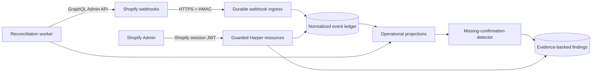

# Sightline by Harper

Sightline is a Shopify operational flight recorder: a read-only record of what happened in a store, when it happened, and where expected operational confirmations are missing.

It runs parallel to Shopify's delivery path. Sightline never proxies merchant traffic or sits between Shopify and fulfillment, inventory, ERP, or other downstream systems. If Sightline is unavailable, the merchant's existing operation continues normally.

## Project status

**Record**, the free MVP, is implemented and running embedded in a Shopify dev store. Milestones M0–M4 are complete; the remaining work is App Store launch readiness ([issue #26](https://github.com/HarperFast/harper-sightline/issues/26)), the only open issue.

- The application: [`app/`](app/) — see [`app/README.md`](app/README.md) for setup and the Fabric dev loop, [`app/DESIGN.md`](app/DESIGN.md) for the runtime map
- Decisions of record: [`docs/adr`](docs/adr) (auth, worker leases, retention/deletion)
- Pinned external contract: [`docs/shopify-contract.md`](docs/shopify-contract.md) · public API: [`contracts/sightline-api-v1.json`](contracts/sightline-api-v1.json)
- Compliance and operations: [threat model](docs/threat-model.md), [security review](docs/security-review.md), [data inventory](docs/data-inventory.md), [reliability report](docs/reliability-report.md), [deployment](docs/deployment.md), [runbooks](docs/runbooks/)
- Launch: [App Store review checklist](docs/app-store-review-checklist.md)
- Design and product source: [screen specification](docs/free_mvp_screen_spec.md), [UX review](docs/ux-review.md), [development plan](docs/free_mvp_development_plan.md), [product brief](docs/sightline_product_brief_v3.md), [App Store concept](docs/sightline_shopify_app_store_mock.html)
- Post-MVP: [Gate 2 pilot design](docs/gate2-pilot-design.md) — designed, deliberately unimplemented

## Free MVP

A merchant installs Sightline from Shopify, opens it inside Shopify Admin, and without configuration:

- records seven days of selected order, fulfillment, inventory, and refund activity;
- searches a normalized operational timeline;
- views order-to-fulfillment flow, an orders worklist, and activity summaries;
- identifies paid, fulfillment-eligible orders with no observed Shopify fulfillment confirmation;
- inspects the evidence and sees findings resolve after a webhook or reconciliation update;
- exports what is on screen as CSV; and
- understands recording health, granted access, retained data, and privacy behavior.

An absence finding means that Sightline has not observed the expected confirmation in Shopify. It does **not** prove that a warehouse, carrier, 3PL, ERP, or other vendor failed.

### Not in the free MVP

- Replay, re-announcement, repair, or any Shopify write operation
- Paid billing and upgrade flows
- Connectors or claims about downstream vendor delivery
- Recovery feeds or artifacts
- Multi-store agency dashboards
- Customer-domain capture
- Google Pub/Sub or EventBridge ingestion
- **Digest delivery** — the operations digest is built and written to an outbox with `status: 'pending'`. There is no sender; a pending row is the finished state.

Paid capabilities are represented only by stable boundaries such as normalized events, capabilities, principals, and transport adapters. There are no placeholder recovery endpoints or speculative paid implementations in the MVP.

## Architecture

Sightline is a Harper v5-native public Shopify application with zero runtime dependencies.

| Concern | Decision |
|---|---|
| Runtime | Harper v5 application, database, resources, workers, and static assets, deployed to Fabric as component `sightline` |
| Interface | Shopify iframe-based App Home using App Bridge and Polaris web components |
| Browser authentication | Short-lived Shopify session JWT, carried in `X-Shopify-Session-Token` and verified by guarded Harper resources |
| Background Shopify access | Expiring offline access and refresh tokens stored as AES-256-GCM credential envelopes, rotated by a scheduled job |
| Webhook delivery | Direct HTTPS with raw-body HMAC verification and idempotent durable acceptance |
| API surface | Purpose-built custom Harper resources under `/api/v1`; application tables are not automatically exported |
| Data model | Sealed GraphQL schemas, tenant keys, Level-1 protected data only, seven-day retention by physical delete |
| Correctness | Deduplication, source timestamps, out-of-order-safe projections, and reconciliation |
| Future identity | A normalized principal boundary can accept Harper OAuth/OIDC identity for standalone agency access later |

Shopify's embedded session token—not a Harper-issued JWT—is authoritative for merchant requests. Harper OAuth is not placed in the free MVP request path because Shopify's embedded token-exchange flow is specialized and cannot depend on third-party cookies.

The public API is `/api/v1/{health, session, setup, summary, events, events/:id, flows, findings, findings/:id, orders, orders/:orderId, export/:kind.csv, privacy, digest}`, pinned in [`contracts/sightline-api-v1.json`](contracts/sightline-api-v1.json). CI fails if the checked-in contract drifts from the code.

## Repository layout

| Path | What |
|---|---|
| [`app/`](app/) | The Harper component: resources, jobs, sealed schema, embedded SPA, tests |
| [`contracts/`](contracts/) | Pinned public API contract, verified by a CI test |
| [`docs/`](docs/) | ADRs, Shopify contract, compliance records, runbooks, product and design sources |
| `shopify.app.toml` | Shopify app configuration: scopes and webhook subscriptions |

Phase 0's throwaway spikes (`spikes/`) and the executed implementation plans have been removed now that their conclusions live in the ADRs and the shipped code; both are recoverable from git history.

## Delivery roadmap

The work was organized into six milestones, all closed except M5:

1. **M0 Risk retirement** — authentication, Shopify contract, Harper worker recovery, and physical deletion proofs ✅
2. **M1 Foundation** — Harper application scaffold, identity, schemas, installation, and credentials ✅
3. **M2 Capture** — webhook ingress, durable processing, normalization, and retention ✅
4. **M3 Intelligence** — projections, reconciliation, detection, aggregates, and query APIs ✅
5. **M4 Experience** — free-tier designs and embedded merchant experience ✅
6. **M5 Launch** — compliance, observability, security, reliability, deployment, and App Store readiness — [#26](https://github.com/HarperFast/harper-sightline/issues/26) open

[Issue #27](https://github.com/HarperFast/harper-sightline/issues/27), the Gate 2 pilot design, was intentionally outside the MVP milestones: it is designed, not built.

## Engineering principles

Development follows Harper engineering guidelines and Harper application best practices:

- TypeStrip-compatible TypeScript with named exports and explicit `.ts` imports
- GraphQL-defined, sealed schemas and query-driven indexes
- Guarded custom resources for all merchant-facing APIs
- Tenant identity derived from authenticated context, never caller input
- Zero runtime dependencies; any new dependency needs written justification
- Iterator- and stream-oriented processing for unbounded data
- Descriptive errors with HTTP status codes and preserved causes
- No sensitive payload, credentials, tokens, or HMAC values in logs
- Unit tests for new modules and changed functions, plus integration and contract coverage
- Formatting, linting, tests, security checks, and independent review before merge

## Development setup

Requirements and the day-to-day loop live in [`app/README.md`](app/README.md): Node 24, access to a Harper v5.2.0 Fabric instance, `npm ci`, then `npm run deploy` and `npm run smoke`. There is no local Harper and no tunnel — the Fabric instance is the runtime and the Shopify App URL points at it. Staged deployment and rollback are documented in [`docs/deployment.md`](docs/deployment.md).

CI runs format, lint, typecheck, unit/integration/contract tests, UI tests, coverage, the SPA build, a dependency audit, and a secret scan.

Do not commit `.env` files, Shopify credentials, token-encryption keys, Harper deployment credentials, or production payloads.

## Contributing

1. Start work from the relevant GitHub issue and confirm its dependencies are complete.
2. Create a descriptive branch from `main`.
3. Keep changes within the issue's acceptance criteria and update design documentation when decisions change.
4. Add appropriate tests and run all available format, lint, test, and security checks.
5. Open a pull request with the purpose, summary, review focus, risk areas, and issue link.

The implementation source of truth is the shipped code plus merged ADRs and issue decisions. The App Store mock is a product-direction artifact and must not override the free MVP's documented claims or boundaries.
