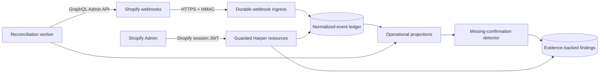

# Sightline by Harper

Sightline is a Shopify operational flight recorder: a read-only record of what happened in a store, when it happened, and where expected operational confirmations are missing.

It runs parallel to Shopify's delivery path. Sightline never proxies merchant traffic or sits between Shopify and fulfillment, inventory, ERP, or other downstream systems. If Sightline is unavailable, the merchant's existing operation continues normally.

## Project status

Sightline is in planning and architecture validation. The current delivery target is **Record**, the free MVP. Application scaffolding and implementation begin with [issue #4](https://github.com/HarperFast/harper-sightline/issues/4) after the Phase 0 architecture risks are resolved.

- [Development plan](docs/free_mvp_development_plan.md)
- [Free MVP screen specification](docs/free_mvp_screen_spec.md)
- [Issue-ready backlog](docs/free_mvp_issue_backlog.md)
- [Product brief](docs/sightline_product_brief_v3.md)
- [App Store concept](docs/sightline_shopify_app_store_mock.html)
- [Planning pull request](https://github.com/HarperFast/harper-sightline/pull/1)

## Free MVP

The free MVP will let a merchant install Sightline from Shopify, open it inside Shopify Admin, and without configuration:

- record seven days of selected order, fulfillment, inventory, and refund activity;
- search a normalized operational timeline;
- view order-to-fulfillment flow and activity summaries;
- identify paid, fulfillment-eligible orders with no observed Shopify fulfillment confirmation;
- inspect the evidence and see findings resolve after a webhook or reconciliation update; and
- understand recording health, granted access, retained data, and privacy behavior.

An absence finding means that Sightline has not observed the expected confirmation in Shopify. It does **not** prove that a warehouse, carrier, 3PL, ERP, or other vendor failed.

### Not in the free MVP

- Replay, re-announcement, repair, or any Shopify write operation
- Paid billing and upgrade flows
- Connectors or claims about downstream vendor delivery
- Recovery feeds or artifacts
- Multi-store agency dashboards
- Customer-domain capture
- Google Pub/Sub or EventBridge ingestion

Paid capabilities are represented only by stable boundaries such as normalized events, capabilities, principals, and transport adapters. There are no placeholder recovery endpoints or speculative paid implementations in the MVP.

## Architecture direction

Sightline will be a Harper v5-native public Shopify application:

| Concern | MVP decision |
|---|---|
| Runtime | Harper v5 application, database, resources, workers, and static assets |
| Interface | Shopify iframe-based App Home using App Bridge and Polaris web components |
| Browser authentication | Short-lived Shopify session JWT verified by guarded Harper resources |
| Background Shopify access | Expiring offline access and refresh tokens stored as encrypted credential envelopes |
| Webhook delivery | Direct HTTPS with raw-body HMAC verification and idempotent durable acceptance |
| API surface | Purpose-built custom Harper resources; application tables are not automatically exported |
| Data model | Sealed GraphQL schemas, tenant keys, minimal protected data, seven-day retention |
| Correctness | Deduplication, source timestamps, out-of-order-safe projections, and reconciliation |
| Future identity | A normalized principal boundary can accept Harper OAuth/OIDC identity for standalone agency access later |

Shopify's embedded session token—not a Harper-issued JWT—is authoritative for merchant requests. Harper OAuth is not placed in the free MVP request path because Shopify's embedded token-exchange flow is specialized and cannot depend on third-party cookies.

## Delivery roadmap

The backlog is organized into six milestones:

1. **M0 Risk retirement** — authentication, Shopify contract, Harper worker recovery, and physical deletion proofs
2. **M1 Foundation** — Harper application scaffold, identity, schemas, installation, and credentials
3. **M2 Capture** — webhook ingress, durable processing, normalization, and retention
4. **M3 Intelligence** — projections, reconciliation, detection, aggregates, and query APIs
5. **M4 Experience** — free-tier designs and embedded merchant experience
6. **M5 Launch** — compliance, observability, security, reliability, deployment, and App Store readiness

See the [open issues](https://github.com/HarperFast/harper-sightline/issues) for executable work and dependencies. [Issue #27](https://github.com/HarperFast/harper-sightline/issues/27), the Gate 2 pilot design, is intentionally outside the MVP milestones.

## Engineering principles

Development follows Harper engineering guidelines and Harper application best practices:

- TypeStrip-compatible TypeScript with named exports and explicit `.ts` imports
- GraphQL-defined, sealed schemas and query-driven indexes
- Guarded custom resources for all merchant-facing APIs
- Tenant identity derived from authenticated context, never caller input
- Minimal dependencies with written justification
- Iterator- and stream-oriented processing for unbounded data
- Descriptive errors with HTTP status codes and preserved causes
- No sensitive payload, credentials, tokens, or HMAC values in logs
- Unit tests for new modules and changed functions, plus integration and contract coverage
- Formatting, linting, tests, security checks, and independent review before merge

## Development setup

The runtime application has not been scaffolded yet, so there is no local start command. [Issue #4](https://github.com/HarperFast/harper-sightline/issues/4) owns the reproducible Harper v5 and Shopify CLI setup and will add:

- supported Node.js and Harper versions;
- dependency installation and local run commands;
- Shopify dev-store and tunnel setup;
- environment-variable documentation;
- formatting, linting, test, and build commands; and
- staging and deployment instructions.

Do not commit `.env` files, Shopify credentials, token-encryption keys, Harper deployment credentials, or production payloads.

## Contributing

1. Start work from the relevant GitHub issue and confirm its dependencies are complete.
2. Create a descriptive branch from `main`.
3. Keep changes within the issue's acceptance criteria and update design documentation when decisions change.
4. Add appropriate tests and run all available format, lint, test, and security checks.
5. Open a pull request with the purpose, summary, review focus, risk areas, and issue link.

The implementation source of truth is the accepted plan plus merged ADRs and issue decisions. The App Store mock is a product-direction artifact and must not override the free MVP's documented claims or boundaries.
