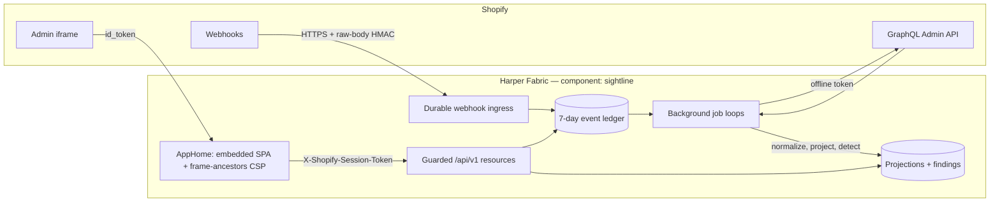

# Sightline by Harper

Sightline is a Shopify operational flight recorder: a read-only record of what happened in a store, when it happened, and where expected operational confirmations are missing.

It runs parallel to Shopify's delivery path. Sightline never proxies merchant traffic and never sits between Shopify and fulfillment, inventory, ERP, or other downstream systems. If Sightline is unavailable, the merchant's existing operation continues normally.

An absence finding means Sightline has not observed the expected confirmation **in Shopify**. It does **not** prove that a warehouse, carrier, 3PL, ERP, or other vendor failed. Every screen, every export, and every document in this repo holds that line.

---

## Current state

**Record**, the free MVP, is built and running embedded in a Shopify dev store. Milestones M0–M4 are closed; the remaining work is App Store launch readiness — [issue #26](https://github.com/HarperFast/harper-sightline/issues/26), the only open issue.

| | |
|---|---|
| Runtime | Harper v5 native component `sightline`, deployed to a Harper Fabric instance |
| Toolchain | Node 24, TypeScript (TypeStrip — no build step for the backend), Vite for the SPA |
| Runtime dependencies | **none** (Node built-ins + the `harper` runtime) |
| Shopify Admin API | pinned to `2026-07`; five read scopes; Protected Customer Data **Level 1 only** |
| Public API | `/api/v1`, pinned in [`contracts/sightline-api-v1.json`](contracts/sightline-api-v1.json) — CI fails if the code drifts from it |
| Retention | 7 days, by physical delete (not TTL or cache eviction) |
| Verification | format, lint, typecheck, unit + integration + contract + UI tests, coverage, SPA build, dependency audit, secret scan — all in CI |

Known gaps, stated rather than implied:

- **Digest delivery has no sender.** The operations digest is built and written to an outbox with `status: 'pending'`; a pending row is the finished state.
- **Secrets custody is not initialised on the dev instance.** The code now reads every secret from Harper's scoped secrets store with no fallback, so until custody is re-initialised Fabric-side (`custody_fingerprint` is null cluster-wide) those values must be supplied as instance env vars or the component will not serve. The burned dev app secret in git history still needs rotating in the Partner Dashboard. See [security review §1.1](docs/security-review.md) and the [deployment steps](#before-the-first-production-deploy).
- **The published listing creative has not been corrected yet** — tracked in #26, itemized in the [App Store review checklist](docs/app-store-review-checklist.md) §3.

---

## What a merchant gets

A merchant installs Sightline from Shopify, opens it inside Shopify Admin, and without configuring anything:

- records seven days of selected order, fulfillment, inventory, and refund activity;
- searches a normalized operational timeline;
- views order-to-fulfillment flow, an orders worklist, and activity summaries;
- sees paid, fulfillment-eligible orders with no observed Shopify fulfillment confirmation;
- inspects the evidence behind each finding, and watches findings resolve when a webhook or a reconciliation sweep supplies the confirmation;
- exports what is on screen as CSV; and
- sees recording health, granted access, retained data, and privacy behavior.

### Not in the free MVP

- Replay, re-announcement, repair, or any Shopify write operation
- Paid billing and upgrade flows
- Connectors, or any claim about downstream vendor delivery
- Recovery feeds or artifacts
- Multi-store agency dashboards
- Customer-domain capture
- Google Pub/Sub or EventBridge ingestion

Paid capabilities exist only as stable boundaries — normalized events, capabilities, principals, transport adapters. There are no placeholder recovery endpoints or speculative paid implementations in the MVP.

---

## Architecture



| Concern | Decision |
|---|---|
| Runtime | One Harper v5 component — database, resources, workers, and static assets — deployed to Fabric as `sightline` |
| Interface | Shopify iframe App Home using App Bridge and Polaris web components, loaded from Shopify's CDN (not npm) |
| Browser authentication | Short-lived Shopify session JWT in `X-Shopify-Session-Token`, verified per request by guarded resources. Harper intercepts `Authorization`, which is why the token rides a custom header ([ADR-001](docs/adr/ADR-001-authentication.md)) |
| Background Shopify access | Expiring offline access + refresh tokens, stored as AES-256-GCM envelopes and rotated by a scheduled job |
| Webhook delivery | Direct HTTPS, raw-body HMAC verified **before** parsing, idempotent on `(shopId, webhookId)` |
| API surface | Purpose-built custom resources under `/api/v1`; no table is `@export`ed, so there is no automatic REST/GraphQL surface at all |
| Tenant isolation | Every query derives `shopId` from the verified principal, never from caller input; an adversarial suite attacks every endpoint |
| Rate limiting | Per shop, per node: 600 requests/min and 10 CSV exports/min, refused with HTTP 429 and a wait time |
| Data model | Sealed GraphQL schemas, tenant-namespaced keys, PCD Level 1 data only, 7-day retention by physical delete ([ADR-003](docs/adr/ADR-003-retention-deletion.md)) |
| Correctness | Deduplication, source timestamps, out-of-order-safe projections, and reconciliation against current Shopify state |
| Future identity | A normalized principal boundary can accept Harper OAuth/OIDC later for standalone agency access, without touching resource logic |

Shopify's embedded session token — not a Harper-issued JWT — is authoritative for merchant requests. Harper OAuth is deliberately not in the MVP request path: Shopify's embedded token-exchange flow is specialized and cannot depend on third-party cookies.

### HTTP surface

| Route | Auth | What |
|---|---|---|
| `GET /` and `/assets/*` | none | The embedded SPA and its assets. HTML carries a `frame-ancestors` CSP built from the verified shop |
| `GET /privacy-policy` | none | The public policy the App Store listing links to |
| `GET /api/v1/health` | none | Liveness, and the guard against "component healthy but no routes registered" |
| `GET /api/v1/{session,setup,summary,events,events/:id,flows,orders,orders/:id,findings,findings/:id,privacy}` | session token | The read API |
| `GET /api/v1/export/{events,findings,orders}.csv` | session token | CSV export of any filtered list, capped at 5000 rows and truncation-labelled |
| `GET`/`PUT /api/v1/digest` | session token | The one write surface — Sightline's own notification settings, never Shopify data |
| `POST /webhooks/shopify/events` | raw-body HMAC | Order, fulfillment, inventory, refund, and `app/uninstalled` deliveries |
| `POST /webhooks/shopify/compliance/*` | raw-body HMAC | Shopify's three mandatory compliance webhooks |
| `GET /api/v1/ops` | `SIGHTLINE_OPS_TOKEN` | Operator health snapshot; 404s while the token is unset |

### Background work

Every sweep is idempotent, resumes from durable state, and is guarded against wedging.

All eight run as **Harper scheduler jobs**, declared in [`app/config.yaml`](app/config.yaml) under `scheduler:` and handled by the `*Job` exports in `app/jobs.ts`. The scheduler is leader-coordinated — each occurrence runs **once, on one elected node**. That matters because `jobs.ts` is imported by every worker thread: as plain `setInterval` timers, all eight sweeps ran on every thread of every node, so each one swept the whole shop list, or the whole Admin API, N×M times over for one node's worth of result.

| Every | Job | Where |
|---|---|---|
| 10s | Process accepted deliveries: normalize → ledger → projection (dead-letters what it cannot process); drains until empty, 8s spent, or 50 rows failed | `sightline-process` |
| 1m | Backfill the derived `state` column on pre-existing projections (converges after a deploy, then silent) | `sightline-state-backfill` |
| 1m | Emit the `ops.snapshot` health heartbeat | `sightline-ops-snapshot` |
| 5m | Expire pending expectations whose deadline passed with no new event | `sightline-detect` |
| 10m | Reconcile against the Admin API (first run backfills 7 days), refreshing credentials as needed | `sightline-reconcile` |
| 15m | Resolve inventory item → product/variant titles and location names | `sightline-inventory-enrich` |
| hourly | Retention purge — physical deletes, verified by re-query (plus one pass 30s after boot) | `sightline-purge` |
| hourly | Build each subscriber's digest for the last complete period | `sightline-digest` |

**Ingest pauses across a leader failover.** Failover completes in ~6.5 minutes, during which no delivery is processed; the backlog is durable, and the first occurrence on the new leader drains it. Because that is longer than the 5-minute `BACKLOG_STALE_MS`, `ops.snapshot` reports the stale backlog until it drains.

Handlers stay wrapped in the stall-guarded ticker (`app/src/jobs/tick.ts`). The scheduler serialises occurrences per job and arms the next one only when the handler settles, with no stall timeout, so a hung handler would stop that job cluster-wide; the handler stops waiting after the ticker's stall budget, and the next occurrence starts a fresh pass.

---

## Repository layout

| Path | What |
|---|---|
| [`app/`](app/) | The Harper component. [`app/README.md`](app/README.md) is the day-to-day loop, [`app/DESIGN.md`](app/DESIGN.md) the module-by-module map |
| `app/src/` | Backend, grouped by concern: `auth/ secrets/ shopify/ ingest/ domain/ api/ digest/ privacy/ retention/ observability/ jobs/ resources/` |
| `app/web/` | The embedded SPA — `view.ts` is every screen as a pure function from data to markup, `main.ts` only fetches and routes |
| `app/test/` | Unit, integration, contract, UI, and adversarial cross-tenant tests (`node --test`, no browser) |
| [`contracts/`](contracts/) | The pinned public API contract, verified by a CI test |
| [`docs/`](docs/) | ADRs, the Shopify contract, compliance records, runbooks, design sources |
| `shopify.app.toml` | Shopify app configuration: URLs, scopes, webhook subscriptions, compliance endpoints |

Phase 0's throwaway spikes and the executed implementation plans were removed once their conclusions moved into the ADRs and the shipped code; both are recoverable from git history.

---

## Getting started

**Prerequisites**

- Node 24 (`nvm use 24`)
- Access to a Harper v5.2.0 Fabric instance — there is **no local Harper and no tunnel**; the Fabric instance is the runtime and Shopify points straight at it
- A Shopify Partner account with a dev store, and the app secret stored in Harper native secrets on the instance (`set_secret SHOPIFY_API_SECRET`, granted to the component named `sightline`)

```bash
cd app
cp .env.example .env    # HARPER_OPS_URL / HARPER_USER / HARPER_PASS / SIGHTLINE_BASE
npm ci
npm test                # unit + integration + contract + UI tests
npm run typecheck && npm run lint:required && npm run format:check
```

`node scripts/seed-dev-data.mjs --dry-run --shop=<store>.myshopify.com` validates a seed offline, and without `--dry-run` populates a dev store's ledger through the real pipeline (it writes accepted deliveries and lets the component derive everything else). `npm run loadtest` proves a webhook burst actually drains, and needs `SIGHTLINE_OPS_TOKEN`.

---

## Shopify integration

Sightline is a **public, embedded, managed-install** app. Shopify CLI owns the app configuration and dev-store install; Harper owns the runtime.

**1. Point the app at your Harper host.** Every URL in [`shopify.app.toml`](shopify.app.toml) carries it — `application_url`, `auth.redirect_urls`, the five webhook `uri`s, and the three `webhooks.privacy_compliance` URLs. They must all name the same HTTPS host that serves the component.

**2. Keep the declared scopes.** `read_orders,read_fulfillments,read_inventory,read_products,read_locations` — no write scopes, and deliberately **not** `read_all_orders` (a rolling 7-day window sits well inside Shopify's default 60-day order access). Changing scopes forces every installed shop to reauthorize. Rationale per scope: [Shopify contract §2](docs/shopify-contract.md).

**3. Get Protected Customer Data Level 1 approval** in the Partner Dashboard (API access → Protected Customer Data Access). The order, fulfillment, and refund topics require it. Every data subscription uses `include_fields` as a whitelist so no customer name, email, phone, or address is ever delivered — Level 2 is neither requested nor needed. Checklist: [Shopify contract §5](docs/shopify-contract.md).

**4. Push the configuration** with the Shopify CLI (`shopify app deploy` creates a new app version from the TOML: scopes, webhook subscriptions, and compliance URLs). `[webhooks] api_version` is pinned to `2026-07`; bumping it each quarter is a **standing maintenance obligation** — Shopify "falls forward" on deprecation, which silently changes payload shapes ([Shopify contract §1](docs/shopify-contract.md)).

**5. Install on the dev store and open the app in Admin.** What happens on that first load:

1. Shopify's managed install grants the declared scopes — there is no OAuth callback to service.
2. Admin frames the app and passes a session token as `?id_token=`. `AppHome` verifies it server-side (HS256 against the app secret), injects the session into the HTML, and serves the SPA with a `frame-ancestors` CSP scoped to the verified shop.
3. That verified token is exchanged once for an **offline** access + refresh token, encrypted at rest, and used only for reconciliation reads. Webhook capture works even if the exchange fails.
4. The SPA then calls `/api/v1/*` with a fresh short-lived token per request in `X-Shopify-Session-Token` (App Bridge forces `Authorization: Bearer`, which Harper's HTTP layer intercepts — hence the custom header).

**6. Verify capture.** Place a test order in the dev store; it should appear on the Events screen within seconds, and the Privacy screen's webhook-capture health should report a recent delivery. `npm run smoke` proves the routes and the auth boundary from the outside.

Uninstall (`app/uninstalled`) deletes the stored credential, marks the shop uninstalled, and drops the notification subscription; Shopify's `shop/redact` and `customers/redact` then erase the shop's records and re-query to confirm none remain.

---

## Deployment

The full pipeline, environment matrix, and secret inventory are in [`docs/deployment.md`](docs/deployment.md). The short version:

**CI** (`.github/workflows/ci.yml`, every PR and push to `main`) runs format → lint → typecheck → tests → coverage → SPA build, plus `npm audit` and a secret scan. All of it must pass to merge.

**CD** (`.github/workflows/deploy.yml`) is **manual dispatch or a published release** — deliberately not auto-on-merge, because the target hosts a live store. Each of `staging` and `production` is a GitHub Environment carrying its own secrets:

| Setting | Used by |
|---|---|
| `HARPER_OPS_URL`, `HARPER_USER`, `HARPER_PASS` | the component deploy (least-privilege deploy user) |
| `SIGHTLINE_BASE` | health poll + smoke test |
| `SHOPIFY_API_SECRET` | app runtime, and the authenticated smoke checks |
| `SHOPIFY_API_KEY` | the app's public client_id — served in the app-home meta tag, not a secret |
| `SIGHTLINE_TOKEN_KEY` | app runtime — 32-byte hex, encrypts the stored Shopify tokens |
| `SIGHTLINE_OPS_TOKEN` | app runtime — gates `/api/v1/ops`; under 32 chars is treated as unset |
| `SIGHTLINE_SUPPORT_*`, `SIGHTLINE_POLICY_UPDATED` | optional runtime settings |

Runtime secrets live on the **Fabric instance**, as **scoped Harper secrets**: `set_secret` with `grants: ['sightline']`, provisioned by [`app/scripts/set-secrets.mjs`](app/scripts/set-secrets.mjs). Scoped values are stored encrypted in `system.hdb_secret`, replicated, and readable only through the component's own `secrets` accessor — they never enter `process.env`, so they are absent from environment dumps and inherited child processes, and a rotation is picked up on the next read with no redeploy.

The three secrets above are declared `required: true` in `app/config.yaml`'s `env:` block, so a deploy missing one **fails at component load with a named reason** — `missing`, `ungranted`, or `custody-unavailable` — rather than starting and failing later. `process.env` remains a fallback in code for local dev and CI only. `deploy.mjs` ships code, never secret values.

**To deploy:** publish a GitHub Release (deploys `production`; the tag is the audit record), or Actions → Deploy → Run workflow with an `environment` and optional `ref`. Locally, `npm run deploy` does the same thing against `.env`.

**What a deploy actually does** — and why it is not just "restart":

1. Builds the SPA, packages `app/`, and calls `deploy_component`.
2. **Discovers every node in the cluster** and restarts each by its own hostname. A Fabric instance can be several nodes behind one hostname; databases replicate between them but **component code does not**, so a restart sent to the load balancer reaches exactly one node and the app flip-flops between versions.
3. Verifies each node serves the hashed SPA bundle the build just produced, then probes the load-balanced hostname repeatedly to catch a mixed cluster.
4. Re-heals the known `@sealed` column-add flake and confirms with `describe_table`.
5. Exits non-zero and names the offending nodes if any of that fails — a half-deployed cluster is worse than a failed deploy.

**Then verify:** `npm run smoke` checks the health route, the unauthenticated 401, a bad-HMAC webhook rejecting with no mutation, and the authenticated reads. `SMOKE_WEBHOOK=1` adds a signed round-trip (writes a synthetic delivery — staging only); `SMOKE_RATE_LIMIT=1` proves the export limit on a single-node target.

**Rollback** is a deploy of an earlier ref: set `ref` to the last-good tag or sha and re-run. All processing is idempotent and durable — accepted deliveries persist, the reconcile cursor resumes, purge is idempotent — so a rollback loses no data. Detail: [deployment-rollback runbook](docs/runbooks/deployment-rollback.md).

### Before the first production deploy

Required owner actions from [security review §1.1](docs/security-review.md). The dev fallbacks are **deleted** — the app now fails closed unconditionally, so these are prerequisites for it serving at all, not hardening on top:

1. **Restore Harper secrets custody on the instance.** Verify with the `get_secrets_public_key` operation; `app/scripts/set-secrets.mjs` refuses to write until it returns a key, because a secret encrypted with no custody is an envelope no node can open.
2. **Rotate** the Shopify app secret in the Partner Dashboard (the committed dev value is burned and remains in git history).
3. Provision the three scoped secrets: `HARPER_OPS_URL=… SHOPIFY_API_SECRET=… SIGHTLINE_TOKEN_KEY=$(openssl rand -hex 32) SIGHTLINE_OPS_TOKEN=$(openssl rand -hex 16) node app/scripts/set-secrets.mjs`, then confirm with `--check`.
4. Redeploy so `config.yaml`'s `env:` block is re-evaluated, and confirm the component loads.

Note that `SIGHTLINE_TOKEN_KEY` cannot be rotated after tokens exist: envelopes are stamped `v: 1` for exactly that purpose, but there is no dual-key decrypt path or re-encrypt sweep yet, so changing the key today invalidates every stored token and forces a reauthorization for every shop.

---

## Documentation

| | |
|---|---|
| **Decisions of record** | [ADR-001 authentication](docs/adr/ADR-001-authentication.md) · [ADR-002 worker leases](docs/adr/ADR-002-worker-lease-scheduling.md) · [ADR-003 retention & deletion](docs/adr/ADR-003-retention-deletion.md) |
| **External contract** | [Shopify contract](docs/shopify-contract.md) (versions, scopes, topics, PCD) · [public API contract](contracts/sightline-api-v1.json) |
| **Compliance & security** | [threat model](docs/threat-model.md) · [security review](docs/security-review.md) · [data inventory](docs/data-inventory.md) |
| **Operations** | [deployment & CI/CD](docs/deployment.md) · [reliability report](docs/reliability-report.md) (load + backup/restore drills) · [runbooks](docs/runbooks/) (one per alert condition, with an alert→runbook→owner map) |
| **Launch** | [App Store review checklist](docs/app-store-review-checklist.md) |
| **Design sources** | [screen specification](docs/free_mvp_screen_spec.md) (cited by name throughout the UI code) · [UX review](docs/ux-review.md) (implementation-grade design record) · [development plan](docs/free_mvp_development_plan.md) (cited as §8/§12/§13/§17 across the code) · [product brief](docs/sightline_product_brief_v3.md) |
| **Post-MVP, designed and deliberately unbuilt** | [Recover tier](docs/recover-tier-design.md) · [Cluster tier](docs/cluster-tier-design.md) · [Gate 2 pilot](docs/gate2-pilot-design.md) |

---

## Engineering principles

Development follows Harper engineering guidelines and Harper application best practices:

- TypeStrip-compatible TypeScript, named exports, explicit `.ts` imports
- GraphQL-defined sealed schemas; indexes driven by the queries that need them
- Guarded custom resources for every merchant-facing API
- Tenant identity derived from authenticated context, never from caller input
- Zero runtime dependencies; any new dependency needs written justification in [`app/dependencies.md`](app/dependencies.md)
- Iterator- and stream-oriented processing for unbounded data
- Descriptive errors with HTTP status codes and preserved causes
- No payload, credential, token, or HMAC values in logs — enforced by key-name redaction, not by care
- Unit tests for new modules and changed functions, plus integration and contract coverage
- Logic that needs a behavior guarantee lives in a deps-injected `src/` module, never inside a file that imports the Harper runtime — `jobs.ts` and `resources.ts` are wiring only, because nothing in them is unit-testable

## Contributing

1. Start from the relevant GitHub issue and confirm its dependencies are complete.
2. Branch from `main` with a descriptive name.
3. Keep changes within the issue's acceptance criteria, and update the design documents when a decision changes.
4. Add tests, and run format, lint, typecheck, tests, and the security checks.
5. Open a pull request stating purpose, summary, review focus, risk areas, and the issue link.

Do not commit `.env` files, Shopify credentials, token-encryption keys, Harper deployment credentials, or production payloads.

The implementation source of truth is the shipped code plus the merged ADRs and issue decisions. Design documents describe intent; where one disagrees with the code, the code is what merchants have — fix whichever is actually wrong.
