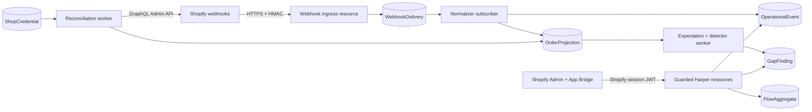

# Sightline Free MVP Development Plan

Status: ready for engineering breakdown

Last validated: 2026-07-13

Product source: [Sightline product brief](./sightline_product_brief_v3.md)

Visual source: [Shopify App Store concept](./sightline_shopify_app_store_mock.html)

## 1. Executive decision

Build Sightline Record as a public, embedded Shopify Admin application running as a Harper v5 native application. The MVP records a deliberately small set of Shopify operational events for seven days, turns them into a searchable timeline and flow summary, and identifies paid, fulfillment-eligible orders for which Shopify has not produced an expected fulfillment confirmation within an evidence-based window.

The free MVP is read-only. It does not replay, re-announce, repair, write tags or metafields, connect foreign systems, bill merchants, or provide multi-store views. Future tiers are enabled through stable boundaries—tenant identity, capabilities, normalized events, detectors, and ingestion adapters—not through empty paid-feature implementations.

Use direct HTTPS app-specific webhook subscriptions. Google Pub/Sub is not part of MVP because it adds operator infrastructure without changing the merchant install experience or proving the product thesis. The ingress boundary must allow Pub/Sub or EventBridge adapters later without changing normalization or detection.

## 2. Product outcome and definition of done

The MVP is complete when a merchant can install Sightline from Shopify, open it inside Shopify Admin, and without configuration:

1. See whether recording and reconciliation are healthy.
2. Search and filter the last seven days of captured operational events.
3. See order-to-fulfillment, inventory, and refund activity over time.
4. Open a finding that says, accurately, “This paid order has no Shopify fulfillment confirmation yet,” including the evidence and elapsed time.
5. See findings resolve when a confirmation arrives or when reconciliation proves current Shopify state.
6. Uninstall the app and have tokens revoked/invalidated and retained shop/customer data handled according to Shopify requirements.

Release evidence must include automated security, tenant-isolation, webhook, reconciliation, detector, retention, and UI tests; a production-like load test; an App Store requirements checklist; runbooks; and a successful dev-store walkthrough.

## 3. Product truth and terminology

The free tier observes Shopify. It cannot know that a 3PL or ERP failed unless that system is connected in a later tier. Therefore MVP copy must use these claims:

- “No Shopify fulfillment confirmation observed” rather than “3PL failed.”
- “Needs attention” or “unconfirmed” rather than “failed” until external evidence exists.
- “Captured events” rather than “every event”; Shopify explicitly says delivery is not guaranteed.
- “Reconciled against current Shopify state” when an Admin API sweep supplies the evidence.

The existing App Store mock is a product-direction artifact. Its replay controls, destination health claims, fictional reviews, “1 click replay,” and failure labels are not acceptance criteria for the free MVP and must not appear in the shipped free application.

## 4. Scope

### In scope

- Public Shopify app configuration and managed installation.
- Embedded iframe App Home using App Bridge and Polaris web components.
- Shopify session-token authentication for browser-to-Harper requests.
- Expiring offline Shopify access and refresh tokens for reconciliation.
- Direct HTTPS, HMAC-verified, idempotent webhook ingestion.
- Seven-day, tenant-isolated operational ledger.
- Normalization, projections, reconciliation, and one production detector.
- Search, timeline, flow summary, finding list/detail, setup/health, and privacy/settings screens.
- Shopify mandatory compliance webhooks and `app/uninstalled` handling.
- Observability, retention, CI/CD, deployment, backups, incident runbooks, and App Store readiness.
- A post-MVP pilot/Gate 2 interface that can export anonymized detector outcomes without requiring schema replacement.

### Explicitly out of scope

- Replay, re-announcement, tag/metafield writes, repair, or any other Shopify mutation.
- Recovery queue UI or functional paid-tier endpoints.
- Billing, trials, paid upgrades, connectors, recovery artifacts, or a public feed.
- Customer-domain capture, marketing/CRM flows, multi-store agency dashboards, or cross-store identity.
- Google Pub/Sub, EventBridge, a dedicated per-merchant cluster, or private deployment.
- Email/SMS/Slack alerts; MVP findings live in the app.
- Guarantees about downstream vendor receipt or processing.
- Gate 1 re-announcement validation and Gate 2 agency-store pilot execution.

## 5. Domain selection

The first release should capture the smallest domain set that makes the “operational flight recorder” useful and supports the initial detector.

| Domain | MVP role | Decision |
|---|---|---|
| Orders/payment | Starts the operational flow and the detector expectation | Include paid, cancellation, and material order-state events |
| Fulfillment | Supplies the confirmation evidence | Include fulfillment create/update events |
| Inventory | High-frequency operational context and a second useful timeline lane | Include inventory-level updates, but no inventory-gap detector yet |
| Refunds | Material exception context for operations and detector suppression | Include refund creation |
| Products | Adds volume but little evidence to the first use case | Defer |
| Customers | Adds protected fields/privacy surface without strengthening MVP | Defer |
| Returns | Valuable later but requires its own state model and detector | Defer |

Exact topic names, payload fields, and scopes must be pinned to the chosen stable Shopify GraphQL Admin API version during foundation work. Use app-specific subscriptions in `shopify.app.toml`, filters where supported, and `include_fields` to minimize received data. Mandatory compliance topics are configured separately.

The initial detector applies only when all of these are true:

- A paid state was observed or established by reconciliation.
- The order contains at least one fulfillment-eligible item.
- The order is not canceled, fully refunded, already fulfilled, or otherwise excluded by a documented rule.
- No qualifying Shopify fulfillment confirmation has been observed by the deadline.

The first deadline is a product constant, not a merchant setting. Start with a conservative value selected from dev-store fixtures and documented merchant expectations, then calibrate it from pilot evidence. Every finding shows the deadline and why the order qualified. The implementation must distinguish `pending`, `unconfirmed`, `resolved`, and `suppressed`; it must never label absence alone as a downstream failure.

## 6. User experience

Use Shopify’s iframe-based App Home because Sightline is intended for public App Store distribution and needs a hosted backend, webhooks, and full browser capabilities. “Embedded” means the merchant opens Sightline from Shopify Admin and the app UI appears within Shopify’s normal navigation and security context.

The frontend is a TypeScript single-page application built with Vite, App Bridge, and Polaris web components and served by Harper’s static plugin. Do not introduce a second application server or server-side rendering for MVP. Shopify CLI remains responsible for Shopify app configuration, dev-store installation, tunneling, and version deployment; Harper remains the data, API, background-work, and static-asset runtime.

Required screens and states are specified in [the MVP screen specification](./free_mvp_screen_spec.md).

## 7. System architecture

### Component boundaries

1. **Shopify identity adapter** verifies Shopify session JWTs and returns a normalized `Principal { shopId, userId, roles, source }`. Resources authorize against `Principal`, not token format. A future Harper OAuth principal can use the same contract for standalone agency users.
2. **Webhook ingress adapter** owns raw-body HMAC verification, headers, deduplication key, minimal parsing, durable acceptance, and rapid 2xx response.
3. **Normalization pipeline** converts versioned Shopify payloads into stable internal event types. Detector and UI code never depend directly on webhook payload shape.
4. **Projection pipeline** maintains the latest known order/fulfillment state with source timestamps so out-of-order delivery cannot rewind state.
5. **Reconciliation adapter** queries the Shopify GraphQL Admin API incrementally and feeds the same normalization/projection path as webhooks.
6. **Detector registry** evaluates projections into versioned findings. MVP registers one detector; paid and later free detectors add modules without changing ingestion.
7. **Capability service** answers named capabilities for a shop. MVP has one `record` entitlement and all recovery capabilities are false. UI and resources use capabilities rather than plan-name string comparisons.
8. **Query resources** return tenant-scoped, purpose-built view models. Ledger tables are not directly exported.
9. **Ingestion transport** begins as HTTPS. A later Pub/Sub adapter must produce the same verified delivery envelope.

### Background work

Use durable tables plus Harper subscriptions for prompt processing. A leased worker/checkpoint record provides single-active ownership and restart recovery in multi-worker or clustered deployments. On startup, workers scan for accepted-but-unprocessed deliveries before subscribing to new writes. Detector and reconciliation jobs are idempotent and checkpointed; no correctness depends solely on an in-memory timer.

The implementation issue must verify the current Harper v5 recommended scheduling/leader pattern before choosing the timer mechanism. This is a bounded platform spike, not permission to add an external queue.

## 8. Authentication and authorization

### Decision

Do not use Harper-issued JWTs for merchant traffic. Shopify Admin supplies a short-lived Shopify-signed session JWT for each embedded frontend request. Harper resources verify its signature, algorithm, audience, destination/shop, issuer, not-before, expiry, and replay-relevant claims before deriving a tenant principal.

Shopify API access is a separate authorization concern. Background reconciliation uses Shopify’s expiring offline access token and refresh token obtained through Shopify token exchange. New public apps are required to use expiring offline tokens. Token rotation must be atomic, and a failed refresh moves the shop to `reauthorization_required` without leaking credentials.

`@harperfast/oauth` supports standard OAuth/OIDC providers and Harper sessions, but Shopify’s embedded session-token and token-exchange flow is specialized and embedded apps cannot depend on third-party session cookies. It is therefore not on the MVP request path. The shared principal boundary preserves a clean future use of the plugin for agency/standalone identity. Before implementation closes the auth epic, record a short ADR confirming whether a supported Shopify provider has since landed in the plugin; do not build a custom provider unless it preserves Shopify’s required session-token behavior.

### Authorization rules

- Every merchant API request is shop-scoped from the verified token, never from a caller-supplied shop ID.
- Every database query includes the derived `shopId` condition.
- Resource responses use explicit field allowlists.
- No application table is `@export`ed; use custom resources with explicit guards.
- Webhook routes authenticate via Shopify HMAC, not merchant JWT.
- Compliance routes validate HMAC and are safe to retry.
- Operations and deployment credentials never share a trust path with merchant requests.
- A cross-tenant test suite attempts ID and filter manipulation against every query resource.

## 9. Data design

Define each table in a dedicated GraphQL schema file. Use `@table`, `@sealed`, explicit primary keys, and only query-driven indexes. Mark internal/credential types hidden where supported. Keep all transactionally coupled application tables in the same Harper database. Do not use `@export` for these tables.

| Table | Purpose | Key/index notes | Lifecycle |
|---|---|---|---|
| `Shop` | Installation, status, scopes, capability profile, reconciliation health | shop domain/ID primary; status indexed | Until uninstall/redaction policy completes |
| `ShopCredential` | Encrypted access/refresh token envelope and expiries | shop ID primary; never returned or logged | Delete/invalidate on uninstall |
| `WebhookDelivery` | Immutable receipt envelope and processing status | composite shop + webhook ID; received/status indexed | Seven days |
| `OperationalEvent` | Normalized append-only business event | event ID; shop/time, shop/topic, shop/resource indexes | Seven days |
| `OrderProjection` | Latest evidence for detector and UI | composite shop + order ID; state/deadline indexed | Seven days after last relevant activity |
| `Expectation` | Expected confirmation and deadline | deterministic detector/order/version ID; state/deadline indexed | Seven days after resolution/expiry |
| `GapFinding` | Versioned, explainable detector outcome | deterministic ID; shop/status/detected time indexed | Seven days |
| `FlowAggregate` | Bounded time-bucket counts for dashboard/flow map | shop + bucket + lane | Seven days |
| `WorkerCheckpoint` | Durable cursor, lease, and retry state | worker/partition primary | Persistent operational state |
| `AppAuditEvent` | Security and lifecycle actions without payload/PII | shop/time and action indexed | Retention set by security policy |

Do not store complete Shopify payloads by default. Configure minimal webhook fields and persist only the identifiers, statuses, timestamps, SKU/quantity facts, and evidence required for the promised views and detector. Explicitly exclude customer name, email, phone, and address. If an implementation finding proves a raw fragment is necessary, document the field-level need, encrypt it, and keep it within the seven-day TTL.

Use the Shopify webhook ID as the delivery idempotency source, namespaced by shop. Preserve source and receipt timestamps. Projection updates compare source version/timestamps so duplicate and out-of-order events cannot regress known state. A webhook receipt, normalization result, and processing checkpoint should commit atomically where they share a request/transaction boundary.

Harper table expiration can enforce the seven-day lifecycle only after an implementation test proves its eviction semantics meet deletion requirements for indexed records and protected data. Otherwise implement an explicit, observable purge job. The plan must not equate cache staleness with legal deletion without verification.

## 10. API surface

All response shapes are versioned application contracts and exposed through guarded custom Harper resources.

| Method/path | Authentication | Purpose |
|---|---|---|
| `POST /webhooks/shopify/events` | Shopify HMAC | Accept app-specific operational webhooks |
| `POST /webhooks/shopify/compliance` | Shopify HMAC | Route mandatory privacy requests by topic |
| `GET /api/v1/session` | Shopify session JWT | Current shop/user and app health |
| `GET /api/v1/summary` | Shopify session JWT | Seven-day totals, health, open findings |
| `GET /api/v1/events` | Shopify session JWT | Cursor-paginated, filtered operational timeline |
| `GET /api/v1/flows` | Shopify session JWT | Bounded aggregate lanes/buckets |
| `GET /api/v1/findings` | Shopify session JWT | Cursor-paginated finding list |
| `GET /api/v1/findings/{id}` | Shopify session JWT | Evidence, state transitions, related events |
| `GET /api/v1/privacy` | Shopify session JWT | Stored categories, retention, deletion state |

Use cursor pagination and bounded date ranges. Do not load table iterators into arrays without a proven bound. Do not expose recovery verbs, placeholder paid endpoints, or client-controlled tenant fields.

## 11. Reconciliation and finding lifecycle

Webhooks are the fast path; Shopify GraphQL Admin API state is the reconciliation source. Reconciliation runs after install/backfill and incrementally thereafter using updated timestamps and durable cursors. It must respect Shopify cost/throttle feedback and resume safely after interruption.

Finding lifecycle:

1. `orders/paid` or reconciled paid state creates/updates an expectation.
2. Cancellation, full refund, ineligibility, or qualifying fulfillment suppresses/resolves it.
3. The detector evaluates due expectations and creates an `unconfirmed` finding with rule version and evidence references.
4. A later webhook or reconciliation pass resolves the finding while preserving its append-only evidence history.
5. Rule changes create a new rule version; they do not silently rewrite why an old finding existed.

Install backfill is limited to what is required for the seven-day product window. Do not request `read_all_orders`; Shopify’s default order access window already exceeds MVP retention.

## 12. Security, privacy, and compliance

- Request only the minimum read scopes required by the selected topics and reconciliation queries; no write scopes.
- Apply for Level 1 protected customer data access because orders, fulfillment, refunds, and related webhooks are protected resources, while avoiding Level 2 identifying fields.
- Verify webhook HMAC from the untouched raw body with constant-time comparison before parsing or writing.
- Deduplicate retries and acknowledge only after durable acceptance.
- Encrypt tokens at rest with envelope/version metadata; secrets and encryption keys come from deployment secret management, never git.
- Use HTTPS, secure headers, strict frame/connect/CORS policies compatible with Shopify, and no wildcard origins.
- Never log tokens, HMAC values, raw payloads, customer data, or full order objects.
- Implement `customers/data_request`, `customers/redact`, and `shop/redact` even if identifying customer fields are not intentionally stored.
- On `app/uninstalled`, mark the installation inactive immediately, stop jobs, and prevent token use. Apply the documented Shopify redaction timing rather than prematurely deleting data Shopify expects retained for the compliance window.
- Separate development/test/production data; never seed tests from production payloads.
- Maintain data inventory, privacy policy inputs, access logging, incident response, backup encryption, restore test, and deletion verification evidence.

## 13. Reliability and observability

### Correctness invariants

- One durable delivery per `(shopId, webhookId)`.
- Duplicate delivery is a successful no-op.
- Out-of-order input cannot regress a projection.
- Every finding names its rule version and supporting evidence.
- A shop can read only its own records.
- An accepted delivery is eventually normalized or visible in a dead-letter state.
- Reconciliation is restartable and never moves its cursor past uncommitted work.
- Seven-day data becomes unavailable and is physically purged according to verified policy.

### Metrics

- Webhook requests, HMAC failures, duplicates, acceptance latency, and non-2xx rate.
- Accepted/processed/dead-letter backlog age and count.
- Events and findings by topic/rule/state, without merchant-identifying labels in global metrics.
- Reconciliation duration, cursor lag, API throttle/cost, refresh failures, and shops needing reauthorization.
- Worker lease health and retry counts.
- API latency/error rate and UI load failures.
- Purge lag and deletion failures.

Trace is the default diagnostic log level. Let top-level handlers log errors once; attach safe correlation IDs and descriptive error types/status codes. Provide dashboards and alerts for webhook rejection spikes, processing lag, reconciliation staleness, token refresh failure, purge failure, and elevated 5xx rates.

Initial performance gates, to be confirmed with representative payloads:

- Webhook acknowledgement p95 below one second and always below Shopify’s five-second timeout under a 100 requests/second burst.
- No lost accepted deliveries during a ten-minute 100 requests/second ingestion test or process restart.
- Merchant query API p95 below 500 ms for a high-volume seven-day fixture on the target MVP cluster shape.
- Processing remains iterator/stream based and memory-bounded as ledger volume grows.

## 14. Engineering standards

- Start from the current Harper v5 TypeScript application template and verify package versions at implementation time.
- Use TypeStrip-compatible TypeScript: erasable syntax, `.ts` import extensions, no enums or parameter properties, named exports, tabs, semicolons, and `node:` built-in imports.
- Prefer platform capabilities and standard APIs; justify every dependency in `dependencies.md`.
- New modules and changed functions require unit tests; target at least 80% coverage, with higher coverage on auth, HMAC, tenant guards, projection, and detector logic.
- Define schemas with GraphQL files and configure GraphQL tooling against Harper’s schema directives.
- Use custom resources for every externally reachable application endpoint. Automatic APIs are intentionally disabled for private ledger tables.
- Use descriptive error subclasses, preserve causes, assign HTTP status codes, and avoid redundant logging.
- Keep hot ingestion paths small and asynchronous; measure before introducing complex performance patterns.
- Maintain `DESIGN.md` as architectural knowledge evolves and use ADRs for auth, retention, scheduler/leases, and detector semantics.
- Run format, lint, unit, integration, contract, UI, and security tests in CI before deployment.
- Non-trivial changes receive second-model review before merge, following Harper engineering guidance.

## 15. Delivery phases

Planning assumption: a small team can parallelize frontend and platform work after the foundation. Sizes and dates must be estimated by the assigned team after issues are created.

### Phase 0 — risk retirement

- Confirm Shopify session-token verification and expiring offline token rotation on Harper v5.
- Confirm `@harperfast/oauth` has no supported Shopify embedded provider that changes the auth decision.
- Confirm Harper worker subscription, lease, scheduling, and TTL/purge behavior.
- Pin Shopify API version, topics, fields, scopes, and protected-data request.
- Write ADRs and a threat model before feature code depends on these choices.

Exit: runnable spikes prove the auth, durable acceptance, worker recovery, and purge assumptions.

### Phase 1 — application foundation

- Scaffold Harper v5, TypeStrip, schemas, resources, Vite frontend, Shopify config, test harness, CI, and local dev-store flow.
- Implement shop/credential lifecycle, capability service, principal contract, and guarded resource base.

Exit: a merchant installs, opens an authenticated empty App Home, and cross-tenant guard tests pass.

### Phase 2 — durable capture

- Implement HMAC/raw-body ingress, deduplication, minimal event envelopes, normalization, dead-letter visibility, and uninstall/compliance routes.
- Add ingestion metrics and burst/restart tests.

Exit: supported dev-store events are durably captured once, processed after restart, and visible through an internal diagnostic resource.

### Phase 3 — projections and reconciliation

- Implement order/fulfillment/inventory/refund normalizers, out-of-order-safe projections, install backfill, incremental reconciliation, token rotation, throttling, and checkpoints.

Exit: projection state converges with Shopify after duplicate, missing, delayed, and out-of-order fixtures.

### Phase 4 — detection

- Implement expectation state machine, detector registry, initial missing-confirmation rule, suppressions, evidence, finding resolution, and aggregate buckets.

Exit: scenario tests demonstrate precise findings and resolution without claiming downstream failure.

### Phase 5 — merchant experience

- Implement setup/health, overview, event timeline/search, flows, finding list/detail, privacy/settings, empty/loading/error/reauthorization states, and responsive/accessibility behavior.

Exit: moderated dev-store walkthrough completes all MVP jobs without raw-log knowledge.

### Phase 6 — production hardening and launch

- Complete retention deletion, security review, load/soak tests, observability, encrypted backup/restore exercise, runbooks, privacy artifacts, App Store checklist, and staged deployment.
- Correct the App Store creative so free-tier claims match shipped behavior.

Exit: release checklist is signed off and a staged production install passes smoke and rollback tests.

### Post-MVP — Gate 2 bolt-on

Add a privacy-reviewed pilot exporter/analysis job over the same normalized events, findings, and rule versions. It reports incident frequency, duration, affected-record counts, resolution source, and lane—aggregated or pseudonymized—without changing ingestion or detector schemas. Gate 2 execution remains a commercial-validation project, not MVP delivery.

Designed in full in the [Gate 2 pilot design](./gate2-pilot-design.md) (issue #27): measures, export contract, the 5–10 store protocol, pre-registered go/no-go thresholds, and the privacy review. Two details from that design worth knowing here: the two-week window is collected by **exporting periodically inside the 7-day retention window** rather than accumulating state in-cluster (so the retention promise and privacy disclosure are unchanged), and **Gate 1 re-announcement validation is the higher-priority prerequisite** for the paid tier — it is cheaper, more decisive, and currently untracked.

## 16. Extension seams for paid tiers

These are contracts, not paid features to implement now:

| Future need | MVP seam |
|---|---|
| Longer retention | Retention policy per capability; all queries accept bounded ranges |
| More detectors | Versioned detector registry over normalized events/projections |
| Foreign connectors | New ingestion adapters emit the same normalized evidence envelope |
| Re-serve feeds | Append-only event IDs and cursor-friendly ordering |
| Re-announcement/repair | Separate command side behind explicit write capabilities and approval audit; absent in MVP |
| Agency identity | Normalized principal contract can accept Harper OAuth/OIDC identity later |
| Multi-store | Tenant keys are present on every record; cross-store queries remain a separate authorized resource |
| Pub/Sub ingestion | Transport adapter feeds the same verified delivery contract |
| Dedicated clusters | No global in-process tenant state; durable leases/checkpoints support relocation |

Do not create recovery tables, fake endpoints, disabled buttons, or speculative connector abstractions in MVP. Add the smallest boundary that prevents coupling, then build future behavior when funded.

## 17. Risks and mitigations

| Risk | Impact | Mitigation/gate |
|---|---|---|
| Absence creates false positives for long/manual/preorder fulfillment | Loss of merchant trust | Conservative eligibility, visible evidence/deadline, suppressions, rule versioning, pilot calibration |
| Shopify OAuth assumptions differ from Harper OAuth plugin | Broken embedded authentication | Phase 0 token-exchange spike; Shopify session JWT remains authoritative |
| Direct HTTPS ingress overloads the app | Missed events | Minimal durable handler, burst test, backlog worker, reconciliation; add Pub/Sub only when metrics justify it |
| Webhooks are missing or out of order | Incorrect history/findings | Idempotency, source timestamps, projections, reconciliation, health visibility |
| Protected customer data blocks App Store review | Launch delay | Minimize fields, avoid Level 2 identifiers, complete Level 1 controls early |
| Seven-day TTL does not physically delete indexed data | Compliance failure | Verify Harper expiration/eviction semantics; explicit purge and deletion test if necessary |
| High-volume inventory updates dominate storage/UI | Cost and noise | Minimal fields, aggregation, bounded queries, load fixture, optional topic filter after measurement |
| Mockup overpromises replay/downstream knowledge | Trust/review failure | Free-specific screen spec and creative correction before submission |
| Clustered workers duplicate scheduled work | Cost/incorrect state | Durable leases, deterministic IDs, idempotent jobs, failover tests |

## 18. Source-of-truth references

Implementation must re-check versioned details at issue start. Current architectural decisions are grounded in:

- [Shopify Apps in App Home](https://shopify.dev/docs/apps/build/app-home)
- [Shopify App Home reference](https://shopify.dev/docs/api/app-home)
- [Shopify session tokens](https://shopify.dev/docs/apps/build/authentication-authorization/session-tokens)
- [Shopify token exchange](https://shopify.dev/docs/apps/build/authentication-authorization/access-tokens/token-exchange)
- [Shopify expiring offline access tokens](https://shopify.dev/docs/apps/build/authentication-authorization/access-tokens/offline-access-tokens)
- [Shopify webhook behavior](https://shopify.dev/docs/apps/build/webhooks)
- [Shopify webhook subscriptions](https://shopify.dev/docs/apps/build/webhooks/subscribe)
- [Shopify privacy-law compliance](https://shopify.dev/docs/apps/build/compliance/privacy-law-compliance)
- [Shopify protected customer data](https://shopify.dev/docs/apps/launch/protected-customer-data)
- [Harper v5 reference](https://docs.harperdb.io/reference/v5)
- [Harper v5 schemas](https://docs.harperdb.io/reference/v5/database/schema)
- [Harper v5 resources](https://docs.harperdb.io/reference/v5/resources/overview)
- [Harper OAuth plugin](https://github.com/HarperFast/oauth)

## 19. Handoff artifacts

- This architecture and delivery plan.
- [Issue-ready backlog](./free_mvp_issue_backlog.md).
- [Screen specification](./free_mvp_screen_spec.md).
- Original product brief and App Store concept retained as source material.

The next repository operation is to create GitHub labels, milestones, and issues from the issue-ready backlog after a remote repository is configured.
