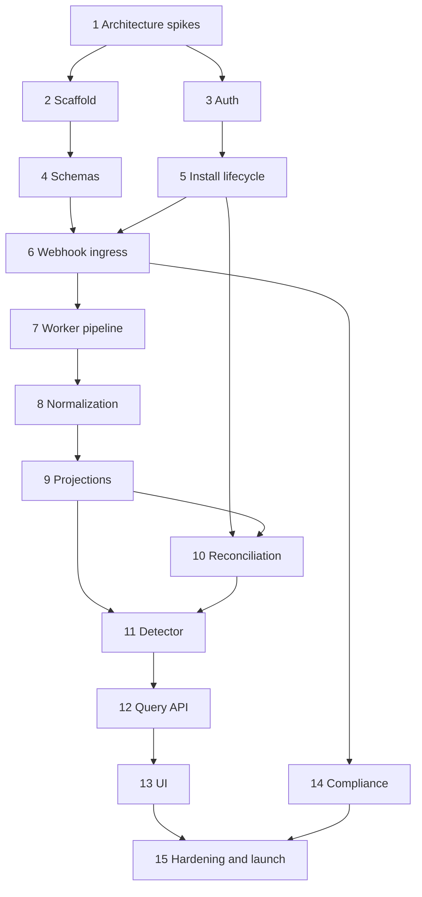

# Sightline Free MVP Issue-Ready Backlog

This backlog is ordered for GitHub issue creation. Each item should become one issue unless implementation discovery shows it is too large for a reviewable pull request. Use milestones `M0 Risk retirement`, `M1 Foundation`, `M2 Capture`, `M3 Intelligence`, `M4 Experience`, and `M5 Launch`.

Recommended labels: `mvp`, `priority:p0|p1|p2`, `area:architecture|shopify|harper|security|data|frontend|testing|ops|docs`, `type:spike|feature|test|docs|ops`, and `blocked`.

## Dependency map

## M0 Risk retirement

### 1. Prove Shopify authentication, Harper worker recovery, and retention assumptions

Labels: `mvp`, `priority:p0`, `type:spike`, `area:architecture`, `area:security`, `area:harper`, `area:shopify`

Outcome: runnable spikes and ADRs resolve the three assumptions most likely to invalidate the architecture.

Acceptance criteria:

- Verify a current Shopify App Bridge session JWT in a Harper v5 custom resource, including negative tests for signature, algorithm, audience, destination/shop, issuer, not-before, and expiry.
- Exchange it for an expiring offline token in a dev store and prove atomic refresh-token rotation.
- Confirm whether `@harperfast/oauth` has a supported Shopify embedded provider; document why it is or is not on the request path.
- Prove a durable subscriber resumes accepted, unprocessed work after process restart and does not double-process under multiple workers.
- Test Harper table expiration/eviction against indexed records and document whether explicit purge is required for physical deletion.
- Record ADRs for authentication, worker lease/scheduling, and retention.

### 2. Pin Shopify API contract, scopes, and protected-data request

Labels: `mvp`, `priority:p0`, `type:spike`, `area:shopify`, `area:security`

Depends on: 1

Acceptance criteria:

- Select and document the stable GraphQL Admin API version.
- List exact app-specific webhook topics, filters, `include_fields`, and required read scopes for orders, fulfillments, inventory, refunds, uninstall, and compliance.
- Demonstrate that no Level 2 customer-identifying fields are required.
- Document Level 1 protected customer data review inputs and the reason each field is needed.
- Confirm default 60-day order access is sufficient; do not request `read_all_orders`.

## M1 Foundation

### 3. Scaffold the Harper v5 native Shopify application

Labels: `mvp`, `priority:p0`, `type:feature`, `area:harper`, `area:shopify`, `area:frontend`

Depends on: 1, 2

Acceptance criteria:

- Harper v5 TypeScript app runs locally with GraphQL schemas, custom resources, static/Vite frontend, and GraphQL tooling.
- Shopify CLI app config installs into a dev store and opens the iframe App Home.
- App Bridge and Polaris web components render an authenticated shell.
- TypeStrip, formatting, linting, unit tests, coverage, and build scripts run in CI.
- `dependencies.md`, `.env.example`, `DESIGN.md`, and local setup instructions exist.
- No secret, `.env`, or built artifact is committed.

### 4. Implement the normalized principal and authorization boundary

Labels: `mvp`, `priority:p0`, `type:feature`, `area:security`, `area:harper`

Depends on: 1, 3

Acceptance criteria:

- A reusable Shopify identity adapter returns a normalized principal from a verified session JWT.
- Guarded resources derive shop identity only from the principal.
- Capability service enables `record` and denies every recovery/write capability.
- Unit tests cover malformed, expired, wrong-shop, wrong-audience, and future token cases.
- A future Harper OAuth principal can satisfy the interface without changing resource business logic; no Harper OAuth login is shipped.

### 5. Define sealed, private Harper schemas and generated types

Labels: `mvp`, `priority:p0`, `type:feature`, `area:data`, `area:harper`

Depends on: 2, 3

Acceptance criteria:

- Dedicated schema files define all tables in the development plan with explicit keys, types, and query-driven indexes.
- Application tables are `@sealed`, non-`@export`, and hidden where appropriate.
- Transactionally coupled tables share one database.
- Schema-generated TypeScript types are usable by resources.
- Migration/compatibility policy and representative fixtures are documented and tested.

### 6. Implement install, credential, reauthorization, and uninstall lifecycle

Labels: `mvp`, `priority:p0`, `type:feature`, `area:shopify`, `area:security`

Depends on: 2, 4, 5

Acceptance criteria:

- Managed installation creates/updates one shop record and stores only an encrypted credential envelope.
- Expiring access/refresh tokens rotate atomically and concurrent refresh is safe.
- Refresh failure stops Admin API jobs and exposes `reauthorization_required`.
- Uninstall immediately disables jobs and credential use and follows documented redaction timing.
- Tokens and identifying payload fields never appear in logs or responses.

## M2 Capture

### 7. Build HMAC-verified, idempotent direct webhook ingress

Labels: `mvp`, `priority:p0`, `type:feature`, `area:shopify`, `area:security`, `area:harper`

Depends on: 5, 6

Acceptance criteria:

- Raw request bytes are authenticated before JSON parsing with constant-time HMAC comparison.
- Supported headers are validated and `(shopId, webhookId)` is a deterministic idempotency key.
- A valid delivery receives 2xx only after durable acceptance; a duplicate is a 2xx no-op.
- Invalid HMAC is 401; malformed/unsupported input uses documented non-retry behavior.
- Handler performs no normalization or Admin API calls before acknowledging.
- Contract tests cover Shopify fixtures, duplicates, malformed payloads, large allowed payloads, and timing-safe verification.

### 8. Build durable processing, retry, and dead-letter handling

Labels: `mvp`, `priority:p0`, `type:feature`, `area:harper`, `area:ops`

Depends on: 1, 7

Acceptance criteria:

- Accepted deliveries are processed through a durable subscription/checkpoint pipeline.
- Startup recovery finds accepted-but-unprocessed rows before live subscription.
- Leases prevent duplicate active workers; deterministic writes make repeats safe.
- Transient failures back off with a bound; permanent failures enter a visible dead-letter state with redacted reason.
- Backlog age/count, retries, worker ownership, and dead letters are observable.
- Restart and multi-worker integration tests pass.

### 9. Normalize Shopify operational events

Labels: `mvp`, `priority:p0`, `type:feature`, `area:data`, `area:shopify`

Depends on: 2, 8

Acceptance criteria:

- Versioned normalizers cover the selected order, fulfillment, inventory, and refund topics.
- Normalized events contain only approved fields and preserve source/receipt timestamps and evidence linkage.
- Unknown additive payload fields do not fail processing; unsupported breaking shapes dead-letter safely.
- No customer name, email, phone, or address is stored.
- Unit/contract fixtures cover every topic and API version.

### 10. Enforce seven-day retention and deletion verification

Labels: `mvp`, `priority:p0`, `type:feature`, `area:data`, `area:security`, `area:ops`

Depends on: 1, 5, 9

Acceptance criteria:

- Ledger, projections, expectations, findings, and aggregates follow their documented lifecycle.
- Purge/expiration handles indexes and physically removes protected data as required.
- Purge lag and failures are observable and alertable.
- Compliance deletion can target shop/customer-linked records idempotently.
- Time-controlled integration tests prove records become unavailable and deleted at the required boundary.

## M3 Intelligence

### 11. Build out-of-order-safe operational projections

Labels: `mvp`, `priority:p0`, `type:feature`, `area:data`

Depends on: 9

Acceptance criteria:

- Order projection tracks payment, eligibility, cancellation/refund, and fulfillment evidence required by the detector.
- Inventory and refund events produce bounded timeline/aggregate facts without speculative status.
- Duplicate and older source states cannot regress a projection.
- Projection rebuild from the normalized ledger yields the same state.
- Scenario tests cover delayed, duplicated, missing, and reordered events.

### 12. Implement install backfill and incremental reconciliation

Labels: `mvp`, `priority:p0`, `type:feature`, `area:shopify`, `area:data`, `area:ops`

Depends on: 6, 11

Acceptance criteria:

- Install backfill is limited to seven days and emits through the same normalized evidence path.
- Incremental queries use durable cursors and Shopify timestamps.
- Shopify throttle/cost response controls pacing and retries.
- Cursor never advances beyond committed projection work.
- Interruption/resume, token refresh, API partial error, and rate-limit tests pass.
- UI health exposes last successful reconciliation and stale/error state.

### 13. Implement the versioned missing-confirmation detector

Labels: `mvp`, `priority:p0`, `type:feature`, `area:data`, `area:testing`

Depends on: 11, 12

Acceptance criteria:

- A documented rule creates an expectation only for paid, fulfillment-eligible orders.
- Cancellation, full refund, ineligibility, and confirmation suppress or resolve expectations correctly.
- Due expectations create deterministic `unconfirmed` findings with rule version and evidence IDs.
- Later webhook or reconciliation evidence resolves the finding without erasing history.
- Copy never claims a downstream vendor failure.
- A decision table and exhaustive scenario tests cover all state transitions.

### 14. Build bounded flow aggregates and query resources

Labels: `mvp`, `priority:p0`, `type:feature`, `area:harper`, `area:data`

Depends on: 4, 10, 13

Acceptance criteria:

- Versioned resources implement session, summary, events, flows, findings, finding detail, and privacy contracts.
- Every query derives `shopId` from the principal and uses cursor pagination/bounded windows.
- Response fields are explicitly allowlisted.
- Aggregate counts reconcile to fixtures and can be rebuilt.
- Cross-tenant ID/filter manipulation tests pass for every resource.
- Generated OpenAPI or equivalent contract artifacts are checked in CI.

## M4 Experience

### 15. Produce free-MVP UX mockups and content review

Labels: `mvp`, `priority:p1`, `type:docs`, `area:frontend`

Depends on: 13, 14

Acceptance criteria:

- Implementation-grade designs cover all screens/states in the screen specification.
- Visualization alternatives work without color and as accessible tables.
- Product/security review approves detector terminology and privacy disclosures.
- Existing App Store concept is annotated or revised so it cannot be mistaken for shipped free functionality.

### 16. Implement setup, overview, and health experience

Labels: `mvp`, `priority:p0`, `type:feature`, `area:frontend`

Depends on: 14, 15

Acceptance criteria:

- First-open accurately tracks installation, webhook, and initial reconciliation state.
- Overview shows recording health, event/finding counts, order-to-fulfillment summary, activity, and recent findings.
- Unhealthy or stale recording never renders as “no gaps.”
- Empty, partial, reauthorization, loading, and error states are complete.
- App Bridge/Polaris, responsive iframe, keyboard, and screen-reader checks pass.

### 17. Implement event timeline and search

Labels: `mvp`, `priority:p0`, `type:feature`, `area:frontend`

Depends on: 14, 15

Acceptance criteria:

- Filters cover time, domain, type, resource/order identifier, SKU, and evidence source.
- URL preserves filters and cursor navigation.
- Event detail shows normalized evidence and related projection/finding links without raw payload or PII.
- Delayed/out-of-order receipt is understandable.
- Large seven-day fixture remains responsive and accessible.

### 18. Implement finding list and evidence detail

Labels: `mvp`, `priority:p0`, `type:feature`, `area:frontend`

Depends on: 14, 15

Acceptance criteria:

- List distinguishes pending-window, unconfirmed, resolved, and suppressed states.
- Detail explains observed evidence, qualification, deadline, reconciliation, and limitations.
- No control mutates Shopify or implies replay.
- Deep links cannot cross tenants and handle expired seven-day records gracefully.

### 19. Implement privacy and app-health screen

Labels: `mvp`, `priority:p1`, `type:feature`, `area:frontend`, `area:security`

Depends on: 10, 14, 15

Acceptance criteria:

- Shows granted scopes, stored/excluded data categories, retention, webhook/reconciliation health, and uninstall/deletion explanation.
- Shows no secrets or internal infrastructure identifiers.
- Content matches privacy policy and protected-data review responses.

## M5 Launch

### 20. Implement mandatory privacy webhooks and deletion workflows

Labels: `mvp`, `priority:p0`, `type:feature`, `area:shopify`, `area:security`

Depends on: 7, 10

Acceptance criteria:

- `customers/data_request`, `customers/redact`, and `shop/redact` are configured, HMAC verified, retry-safe, and audited.
- Data inventory maps every table/field to request, export, or deletion behavior.
- Invalid HMAC returns 401 and no mutation.
- Shopify test payloads and deletion verification tests pass.

### 21. Add production observability and runbooks

Labels: `mvp`, `priority:p0`, `type:ops`, `area:ops`

Depends on: 8, 10, 12, 14

Acceptance criteria:

- Metrics and alerts from the development plan exist in staging.
- Logs use safe correlation IDs and contain no token, HMAC, raw payload, or customer data.
- Runbooks cover webhook rejection/backlog, dead letters, stale reconciliation, token refresh failure, purge failure, deployment rollback, and Shopify outage.
- Alert drills identify the correct runbook and owner.

### 22. Complete security and tenant-isolation review

Labels: `mvp`, `priority:p0`, `type:test`, `area:security`

Depends on: 14, 20, 21

Acceptance criteria:

- Threat model covers install/auth, iframe/browser, webhook, token storage, Admin API, workers, data access, deployment, and supply chain.
- Automated cross-tenant suite covers every endpoint and manipulated identifiers/filters.
- Dependency audit and secret scan pass; each dependency is justified.
- Encryption-at-rest/in-transit and backup encryption are evidenced.
- Independent review findings are fixed or explicitly accepted by an owner.

### 23. Run reliability, load, retention, backup, and restore tests

Labels: `mvp`, `priority:p0`, `type:test`, `area:testing`, `area:ops`

Depends on: 10, 12, 14, 21

Acceptance criteria:

- Webhook latency and ten-minute 100 rps burst/restart gates pass or approved replacement targets are documented.
- No accepted delivery is lost and processing catches up after restart.
- High-volume seven-day query latency meets the agreed target with bounded memory.
- Seven-day purge, encrypted backup, and restore exercises pass in a production-like environment.
- Results and capacity assumptions are committed.

### 24. Establish staged Harper Fabric deployment and CI/CD

Labels: `mvp`, `priority:p0`, `type:ops`, `area:harper`, `area:ops`

Depends on: 3, 21, 22, 23

Acceptance criteria:

- Separate development, staging, and production configuration/secrets exist.
- CI runs format, lint, unit, integration, contract, UI, coverage, and security checks.
- Deployment is versioned, least-privilege, auditable, and has a tested rollback.
- Staging smoke tests include Shopify install, authenticated API, webhook, reconciliation, finding, uninstall, and privacy flow.

### 25. Complete Shopify App Store launch readiness

Labels: `mvp`, `priority:p0`, `type:docs`, `area:shopify`, `area:security`

Depends on: 16–24

Acceptance criteria:

- App review checklist, protected-data submission, privacy policy, support/contact surface, install/uninstall, and compliance webhooks are complete.
- App listing claims and screenshots match the free product; fictional reviews and functional replay claims are removed.
- A clean production-store install completes the definition-of-done walkthrough.
- Release owner signs off security, operations, product truth, and rollback readiness.

### 26. Add the post-MVP Gate 2 pilot adapter design

Labels: `priority:p2`, `type:docs`, `area:architecture`, `area:data`

Depends on: 13, 21

This issue is not part of the MVP milestone.

Acceptance criteria:

- Specify aggregated/pseudonymized measures for incident rate, duration, affected records, lane, rule version, and resolution source.
- Reuse normalized events/findings without changing MVP schemas or detector behavior.
- Complete privacy review and define export access/retention before implementation.
- Define the five-to-ten-store pilot protocol and commercial go/no-go thresholds separately from product code.
